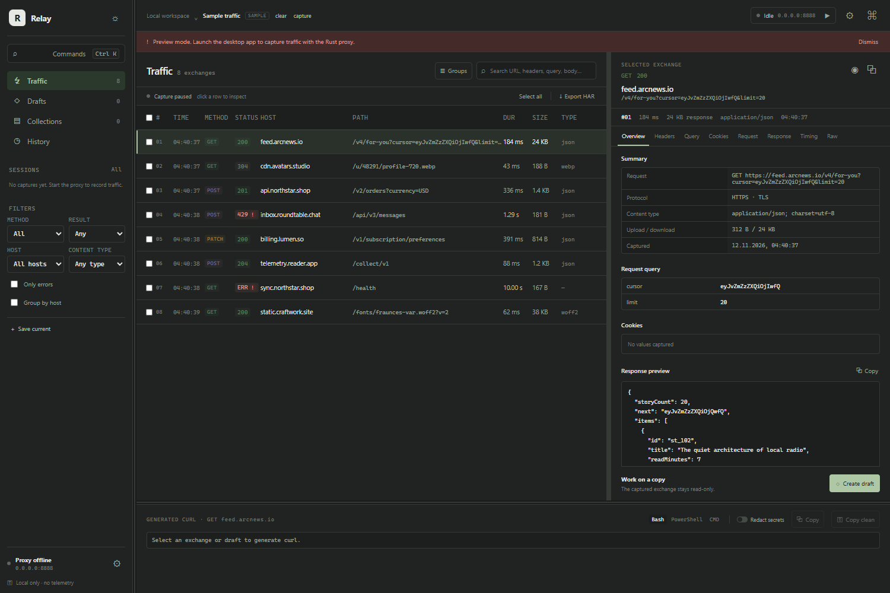
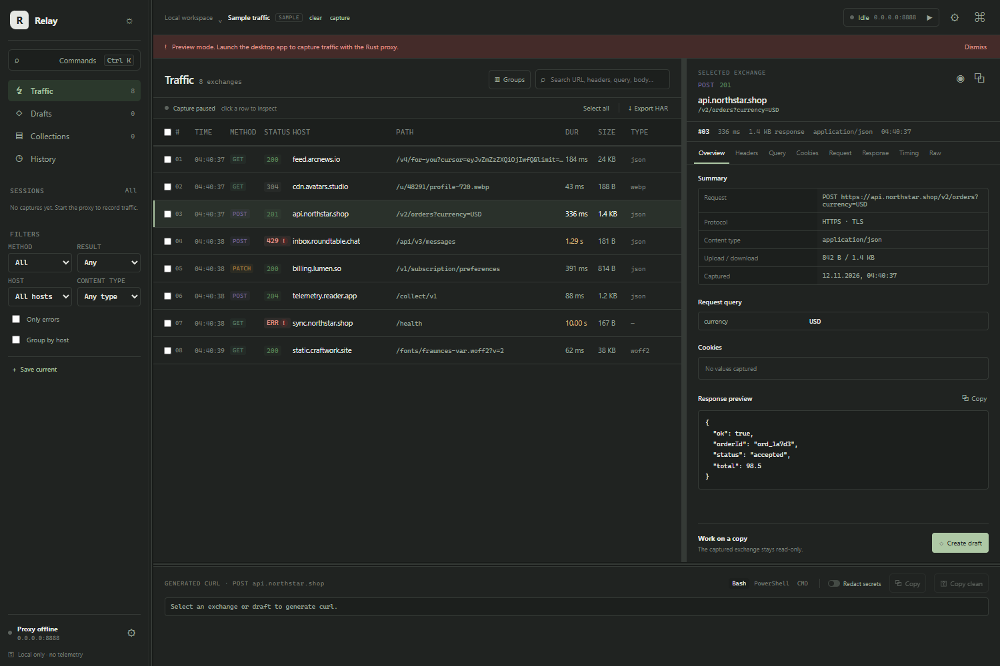
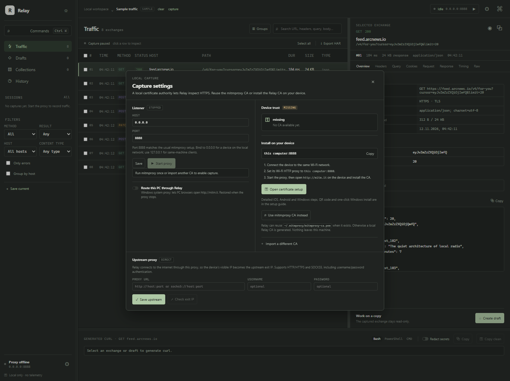
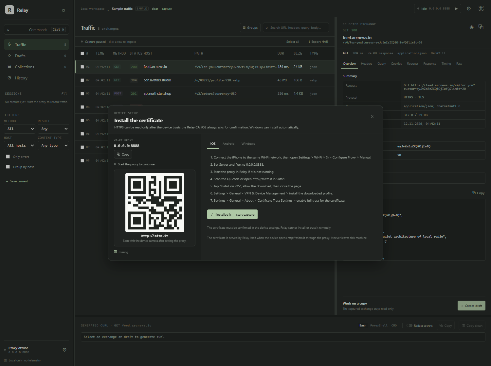
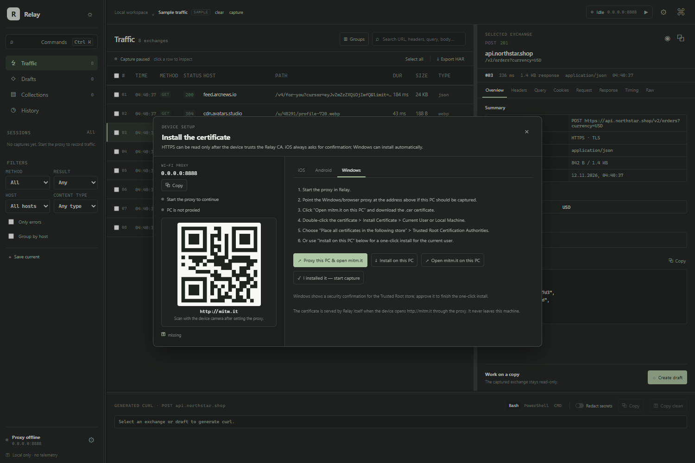
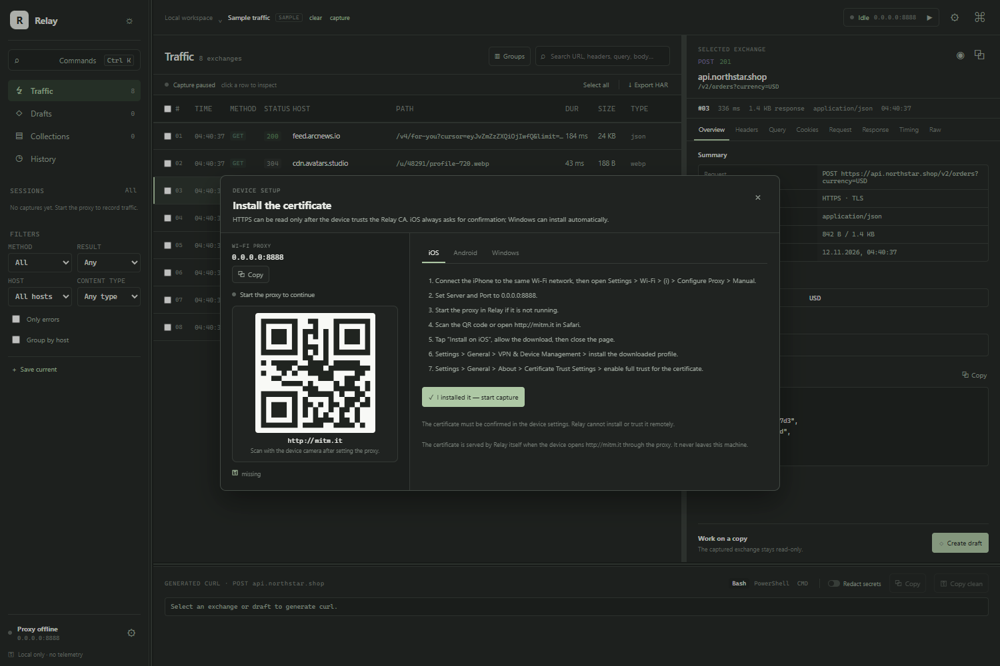
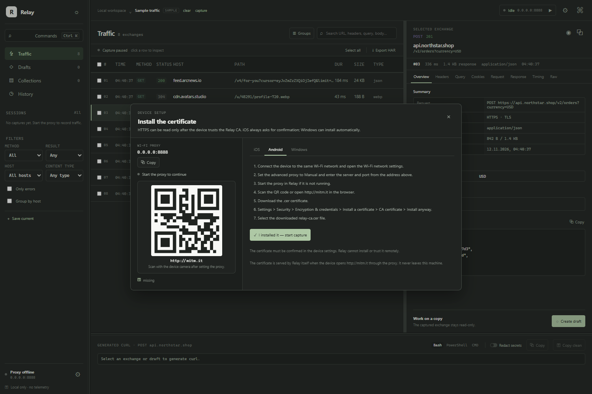

# Relay

**A local HTTP/HTTPS traffic inspector for Windows.** Relay runs a Rust-native MITM proxy, streams captures from your phone, tablet or PC into a fast desktop UI, and keeps everything on your machine — no Python, no Electron, no cloud.

[](https://github.com/lightlame/relay/actions/workflows/ci.yml)
[](LICENSE)
[](#requirements)
[](https://tauri.app)
[](https://www.rust-lang.org)



## Why Relay

Most traffic tools are either heavyweight proxies with a Python stack or browser-only DevTools that cannot see a phone. Relay is a single native Windows app:

- **Rust MITM proxy** — HTTP/1.1 and HTTPS interception with on-the-fly leaf certificates.
- **One workspace** — live traffic, inspector, drafts, replay, curl and HAR in the same window.
- **Local by design** — captures, the CA key and settings live in a local SQLite database. Nothing is uploaded.
- **Fast UI** — React + TypeScript in a Tauri WebView, no Electron runtime.

## Features

**Capture**
- Start and stop a local MITM proxy on a configurable host and port.
- Generate a local CA, import your own, or reuse `~/.mitmproxy/mitmproxy-ca.pem`.
- Built-in `http://mitm.it` page and QR code for installing the CA on a device.
- Optional upstream proxy (HTTP, HTTPS, SOCKS5) with credentials and an exit-IP check.
- Optional Windows system proxy so this PC can browse through Relay.

**Inspect**
- Dense live table: method, status, host, path, duration, size and content type.
- Search across URL, headers, query and bodies.
- Filters for method, result, host, content type and errors; save reusable filter presets.
- Group by host, multi-select, save to collections or delete in bulk.
- Inspector tabs: Overview, Headers, Query, Cookies, Request, Response, Timing, Raw.
- Pretty JSON/form/text, gzip/brotli/deflate/zstd decoding, base64 payloads.

**Replay and export**
- Captured exchanges are immutable; edits happen in a separate draft.
- Draft diff against the original request and response comparison after replay.
- Replay with timeout, redirect and proxy options.
- curl export for Bash, PowerShell and CMD, with a redacted variant.
- HAR 1.2 export with secrets masked.

**Quality of life**
- Light and dark themes, command palette, keyboard shortcuts, resizable panels.
- Secret masking for Authorization, cookies, tokens, API keys, passwords and URL userinfo.
- No telemetry, analytics, remote fonts or cloud dependencies.

## Screenshots

| Traffic and inspector | Capture settings |
| --- | --- |
|  |  |

| Certificate setup | Windows PC capture |
| --- | --- |
|  |  |

<details>
<summary>Device-specific certificate steps</summary>

| iOS | Android |
| --- | --- |
|  |  |

</details>

## Requirements

- Windows 10 1803+ or Windows 11 (x64).
- WebView2 runtime. It ships with current Windows; the installer can download it if missing.
- To build: Rust stable with the MSVC toolchain, Node.js 20+, Visual Studio Build Tools with the **Desktop development with C++** workload, and the Windows SDK.
- Network access for the first `cargo`/`npm` install and for Tauri's NSIS/WiX tools.

## Install

Download the latest installer from [Releases](https://github.com/lightlame/relay/releases):

- `Relay_0.1.0_x64-setup.exe` — NSIS installer.
- `Relay_0.1.0_x64_en-US.msi` — MSI package.

Or run the portable binary `Relay.exe` produced by a local build.

## Quick start

1. Open **Capture settings** and start the proxy (default `0.0.0.0:8888`).
2. On the device, set the Wi-Fi HTTP proxy to `<this-PC-LAN-IP>:8888`.
3. Open `http://mitm.it` on the device and install the Relay CA.
4. Trust the CA: iOS uses **Settings → General → About → Certificate Trust Settings**; Android uses **Settings → Security → Encryption & credentials → Install a certificate**.
5. Browse on the device. Requests appear in Relay in real time.

> Only install the CA on devices you own and only inspect traffic you are authorized to inspect.

## Build

```powershell
npm ci
npm --prefix frontend ci
npm run tauri build
```

Artifacts:

- `target/release/Relay.exe`
- `target/release/bundle/nsis/Relay_0.1.0_x64-setup.exe`
- `target/release/bundle/msi/Relay_0.1.0_x64_en-US.msi`

Development:

```powershell
npm run tauri dev
```

The frontend can also run without the desktop backend for layout work:

```powershell
npm run dev
```

## Checks

```powershell
npm run check:web
npm run check:rust
```

`check:rust` runs rustfmt, clippy with `-D warnings`, and the workspace tests. The ignored network tests can be run with:

```powershell
cargo test -p test_fixtures -- --ignored
```

They exercise a real HTTPS MITM roundtrip and require internet access.

## Architecture

| Path | Responsibility |
| --- | --- |
| `src-tauri` | Tauri commands, app state, event bridge, Windows system proxy |
| `crates/domain` | Shared models, filters, drafts, diff types |
| `crates/proxy` | Rust MITM proxy, `mitm.it`, upstream routing |
| `crates/replay` | Draft replay and response comparison |
| `crates/curl_export` | Bash, PowerShell and CMD curl generation |
| `crates/storage` | SQLite sessions, exchanges, drafts, collections, filters, HAR |
| `crates/security` | Secret masking, CA validation, PKCS#1 → PKCS#8 conversion |
| `frontend` | React + TypeScript UI |
| `test_fixtures` | Local and network integration tests |

## Privacy and security

- Relay listens on `0.0.0.0:8888` by default so a device on the LAN can reach it. Bind `127.0.0.1` when only this PC needs capture.
- The CA private key and upstream credentials are stored in the local SQLite database in the app-data directory and are never uploaded.
- HAR export masks Authorization headers, cookies, tokens, API keys and passwords.
- Masks are applied to structured query/cookie fields as well as raw text and URL userinfo.
- Relay is a debugging tool, not a security boundary. Do not expose the proxy port to untrusted networks.

See [SECURITY.md](SECURITY.md) for the disclosure policy.

## Contributing

Issues and pull requests are welcome. Read [CONTRIBUTING.md](CONTRIBUTING.md) first.

## License

MIT. See [LICENSE](LICENSE).

Relay is an independent local debugging tool and is not affiliated with mitmproxy.
